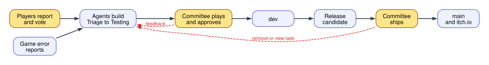
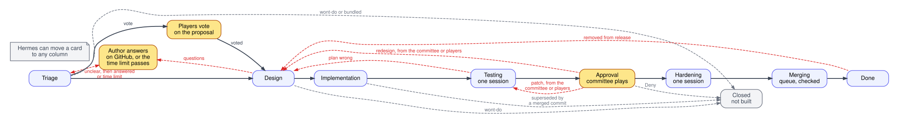
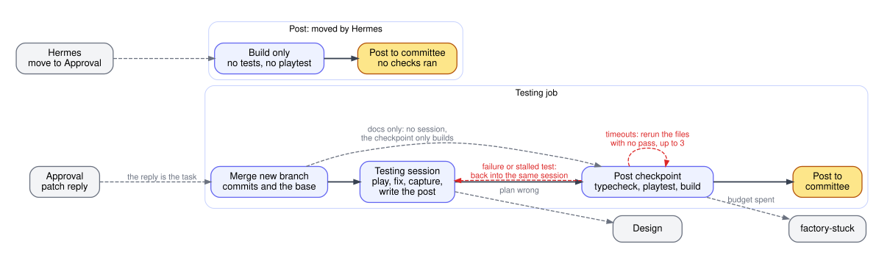
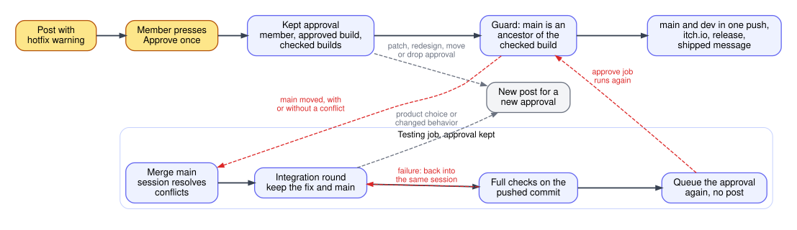
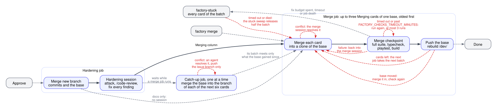
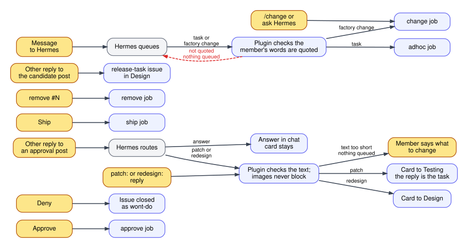
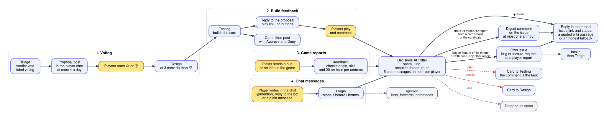
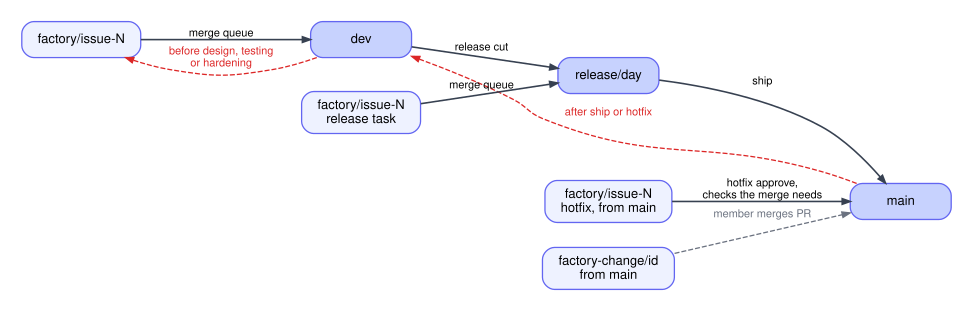
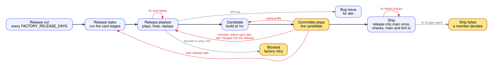
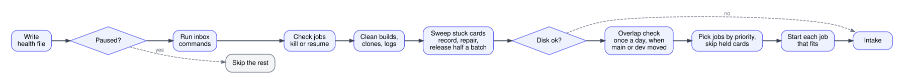

# Factory process

This file is the spec of how the factory works. Each diagram matches the code, and a change to the process updates its diagram in the same commit. The rules behind each step are in [stages.md](stages.md), [evidence.md](evidence.md) and [operations.md](operations.md). [state.md](state.md) describes the stores, card positions, queues and health records.

Every fact the factory acts on comes from a structured record: the ledger, state, a typed error or an API field. The factory never parses text it wrote itself to learn a fact back. Text in comments, logs and notes is for people.

The diagrams are Graphviz files in [diagrams/](diagrams/). Agents read the `.dot` source. People see the `.svg` render. After you edit a `.dot` file, run `npm run diagrams` from `factory/`, or a test fails. It needs Graphviz installed. The colors mean the same in every diagram:

- Black arrows are the normal path, from left to right.
- Red dashed arrows are loops back.
- Grey dashed arrows end the flow early or leave it.
- Yellow boxes wait for people.

## Overview

The public files GitHub issues and sends reports from the game. The game's release, dev and candidate builds also report their errors, and each new error becomes a bug issue. Triage sends bugs and justified improvements to work at once. A real feature goes to the player chat as a proposal, and players vote on it with reactions. Agents design, build and test the work. The committee plays each result in Telegram and approves it. Approved work collects on `dev` and ships as a release to `main` and itch.io. Hermes handles every failure.

## Card lifecycle

A card is one GitHub issue on the Project board. Its column is the state. Every card runs the same stages. Testing gets a build ready for the committee to play. Hardening runs after they approve it, with the deep verification and the review. Hardening is slow, so it runs only on work the committee wants. Merging checks the approved cards merged together before the base takes them.

Each agent stage is one agent session that owns its stage. Each session first reads the game docs that cover its task, as [stages.md](stages.md#game-docs-first) says. The agent runs the checks itself and fixes what it finds. Hard checks run only at six checkpoints: the diff guard on every commit and every push, the post checkpoint before a committee post, the hardening suite before Merging, the merge checkpoint before the base takes a card, the release playtest before the candidate, and the ship checkpoint before `main` takes the release. A checkpoint failure goes back into the session that did the work, until the checks pass or the stage spent its budget, `FACTORY_TESTING_BUDGET_USD`, `FACTORY_HARDENING_BUDGET_USD` or `FACTORY_MERGING_BUDGET_USD`. At the hardening, merge and ship checkpoints only the fix rounds count against that budget, so an expensive conflict still leaves the session its fixes. Everything else an agent writes, like the post text and its screenshots, is shown as written.

- Intake takes every aged `bug` and `feature-request` issue into Triage. A `player-report` or `error-report` issue goes in at once, since nobody edits it after it is filed. Nobody votes on GitHub.
- Triage first runs a cheap filter. It refuses junk that asks for no game change and passes a bug to Design. It never asks questions.
- Triage grooms every request that is not a bug before it goes to Design or to a vote. The groomer decides everything else: a justified improvement of an existing thing goes to Design, and a new feature or a substantial change gets the verdict `vote` and the label `voting`, and waits in Triage for player votes, as [Public inputs](#public-inputs) says. A bug is never put to a vote. A player does not know all the game has, so grooming finds the real need behind the request and the version of it that fits ROAM. That version can differ from the literal ask, and design builds it. When the game already serves the need, grooming refuses the request and names what serves it. [stages.md](stages.md#triage) has the details.
- A bug a collaborator labels `hotfix` skips Triage. Triage can also label a bug `hotfix`. Approve ships a hotfix at once, and the approval stays until the hotfix ships, as [Hotfix approval](#hotfix-approval) says.
- The error service opens an `error-report` bug for each new game error, at most `FACTORY_ERROR_DAILY_ISSUES` a day. Intake takes it into Triage with no votes. A later report of the same error from a new build comments on its issue, and reopens a fixed one when the build came after the fix. [operations.md](operations.md#error-reports) has the details.
- Triage labels a fix of an open release's feature `release-task`, until the release's candidate is posted. It runs on the release branch and ships with that release. New work stays on `dev` for the next release.
- A merged issue stays open with the label `release-candidate`. It closes when its release ships.

The loops:

- unclear and questions: only the groomer and design ask, every question in one set. The author gets them on GitHub with an @mention, and the committee chat gets them with the issue and the reason. The label `needs-info` holds the card. A reply to that chat message goes on the issue as the answer and removes the label. The tick also removes it once someone answers on GitHub, or once `FACTORY_NEEDS_INFO_HOURS` pass with no answer. Triage then runs again. With no answer it picks the most sensible reading, and design writes each open question and its reading into the design comment as an assumption.
- plan wrong: the testing agent found that the plan itself contradicts the issue or the game docs, so no fix of the build can satisfy both. The card keeps its branch.
- patch: a small committee change. The card goes back to Testing, whose session takes the reply as its whole task.
- main moved: an approved hotfix whose checked build no longer sits on `main`. The card goes back to Testing with its approval kept, and comes back to Approval with no post.
- redesign: the committee reply changes the plan.
- removed from release: `remove #N` on the release candidate post.

Every other problem is fixed inside the stage that found it: a bug, a wrong look, a failed check, a review finding or a merge conflict.

The early ends:

- wont-do: triage or design refuses the request, and the issue closes.
- bundled: triage folds the issue into a lead, and it closes when the lead ships. A duplicate of a card already in work joins that card the same way, a hotfix too.
- Deny: the committee rejects the build, and the issue closes.

A branch that changes only Markdown docs cannot change the game, so it runs no testing or hardening session, and its post checkpoint only builds it. The merge checkpoint still checks it. A wiki page in `game/docs/wiki/` does not count as docs, since the game tests check its tables. [stages.md](stages.md#docs-changes) has the rules.

Screenshots never block a card. A card with no screenshot still runs the post checkpoint, and its approval post is text that says it has no screenshot. [evidence.md](evidence.md) has the rules.

A failed job never moves a card. A card stage that fails resumes once on the next tick in its own sessions, and its agent gets the error. Its sessions stay after a later failure too, so the stage resumes them whenever it starts again. A second failure labels the issue `factory-stuck`, and the card waits in its column until Hermes removes the label. An empty budget or a question for the committee labels it at once. Each tick's stuck sweep records why every stuck card waits, and removes the label itself only for a mechanical cause: a stale merge in the card's work clone, a GitHub outage or full disk that has passed, and a merge batch that timed out. [operations.md](operations.md#stuck-sweep) has the rules. A run that hits the Claude weekly usage limit pauses the factory instead, and its card takes no label.

A member or Hermes can hold one card with `factory pause-card N`, so its worker goes to other work, like release tasks. The hold stops the card's job and keeps its work clone and agent sessions. The card waits in its column with no label until `factory resume-card N`, and then the stopped stage continues where it stopped. [state.md](state.md) has the rules.

Every column change writes a card line to the ledger, named by its arrow in the diagram. The public dashboard reads these lines for its delivery numbers. [operations.md](operations.md#ledger-and-waste-review) lists the names.

Hermes can put a card in any position with `factory move`. The board column is the position, so a move changes the column and clears what the old position kept in the state. [state.md](state.md) lists the positions.

## Testing column

Testing is one job. The testing session merges the base, plays the build, fixes what it finds and writes the post text and its screenshots. Then the factory pushes the branch and runs the post checkpoint in a fresh clone: `npm ci` and the build, which also typechecks. The session already ran the tests near its change and played the build. The post checkpoint also runs the full suite on GitHub Actions for every card, beside the build. A failure goes back into the same session. The tests that fail on the card's base too are not the card's to fix, and a run whose only failures are the base's passes the card. The factory records that pass in `suiteCleared`. A branch that changes no game file other than untested docs runs no suite. A passing build is published and posted to the committee.

Nothing posts a build, and nothing queues a kept approval, unless the build's head has a green suite. The record is the `game suite` commit status on the head, or `suiteCleared`. Posts and checkpoints check the exact head, so a head that merged a new base runs the suite again. A branch that changes no game file other than untested docs needs none. Otherwise the post fails with a typed error.

- A hotfix ships on approval, so its session first runs the hardening prompt, and its post checkpoint also runs the full suite on GitHub Actions and the playtest. It never enters Hardening.
- Hermes can move a card to Approval with no testing. A checks job then builds the branch, runs the full suite and posts it with no testing agent, and the post says so. A failed suite fails the job.
- A hotfix with a kept approval runs the integration round in place of the hardening and test rounds, and its passing checks queue the approval again in place of a post.

## Hotfix approval

The factory's job is to need people as little as it can. A member approves a hotfix once, and the approval stays with the approved build, the member and each checked build that came from it, in `keptApprovals`. Newer `main` merged in mechanically, a retry, a restart or a failed check never asks for it again.

- `main` takes only the build whose full suite, playtest and build passed, and only while `main` is an ancestor of it. A `main` that moved before the push, with or without a conflict, sends the card back to Testing with the approval kept. Testing merges `main`, resolves any conflict in its session, runs the full checks on the exact pushed commit and queues the approval again.
- The approval drops with its reason, and the changed build gets a normal post, when the merge needs a product choice or changes what the committee played, when a member patches, redesigns or denies it, when a move sends the card elsewhere, and when `factory drop approval N` revokes it.
- Only a member's press creates a kept approval. So an unapproved hotfix never ships.
- Approve and Deny work only from the card's current post. An older post gets an error reply.
- The hotfix still pushes `main` and `dev` in one atomic push.
- A hotfix branch never carries a commit that is on `dev` and not on `main`. Every card branch push on a `main` base, and the approve job on the build, run this check. A hit rebuilds the card: the factory deletes the branch and the work clone, comments the commit count on the issue and moves the card to Design, which starts a clean branch from `main`. A card filed with the `hotfix` label gets its first clone from `main` in Triage.

## Hardening and Merging columns

Approve moves a card to Hardening. The hardening session merges the base, attacks the change, runs `/code-review` and fixes every finding. Then the factory pushes the branch and runs the full suite on GitHub Actions on the pushed head, with the base's failures dropped as in Testing. It skips the suite when the head already has a green suite or the branch changes no game file other than untested docs. A failure goes back into the same hardening session, until the suite passes or the fix rounds spent `FACTORY_HARDENING_BUDGET_USD`. The hardening run itself spends none of that budget. Then the card moves to Merging.

A card enters Merging only with a green suite on its own work. `factory merge N` and `factory move N merging` send a card with none to Hardening instead, which runs the suite and then moves it to Merging. A catch-up merges the base into a waiting card and adds no work of the card's own, so this check walks back from the head past merges of the base to the card's own last commit, and a green record on any commit of that walk counts. The merge checkpoint then tests the merged result. Each merge job checks every waiting card the same way before it picks a batch, so a card moved to Merging by hand on the board also goes to Hardening first. The cards of a kept merge batch stay, so their kept work resumes.

A merge job takes up to three Merging cards of one base, the oldest first. It merges them into a clone of the base, and the merge session resolves any conflict. The clone, the merge session and the fix spend belong to the batch, not the job: a job that fails, dies or times out leaves them in place, and the next job on the same batch with the same branch heads resumes them. It takes that batch first, and the stuck sweep releases it whole. Ship keeps its work the same way. Each time a base moves, a catch-up job merges it into the issue branch of every card waiting on it, one at a time, and an agent resolves any conflict there, so the next batch meets only what the batch before it landed. A catch-up skips the cards a merge job took or is about to take, pushes only the issue branch, runs no checks, and a failed one labels nothing. The merge checkpoint runs the full suite on GitHub Actions for the result, and the playtest and the build on the server at the same time. A batch that changes only untested docs runs no suite. Each run of the server checks stops at `FACTORY_CHECKS_TIMEOUT_MINUTES` and counts as a timeout, which runs them again, at most 3 times. A run counts as a timeout only when no error other than a test timeout appears anywhere in its output, so a failure that scrolled above the log tail still goes to the merge session, with its error lines above the tail. Three timeouts fail the job with the cause `timeout`, so the stuck sweep splits the batch. The suite runner passes a run in which every test file and test passed and the only unhandled errors are Vitest's worker RPC timeouts on `onTaskUpdate`, so a lost progress update after a complete pass does not rerun the checks. A stalled test is a real failure. A suite that could not run, or ran past its time limit with no failed test, fails the job as a machine failure for the stuck sweep. A failure goes back into the merge session, until the checks pass or its fix rounds spent `FACTORY_MERGING_BUDGET_USD`. A suite failure lists every failed test and every unfinished file of the run's `test-failures` record above the log tail, and the session fixes them all in one round, since each full suite costs up to 20 minutes. A fix round that made no commit runs no checks: the same failure goes back to the session with that note, and the round still counts against the budget. When the suite fails, the job reads the failed tests from the run's `test-failures` record and reruns only their files on the base's tip on GitHub Actions, with one worker. A failed test that fails the same way there is the base's, while a file that failed as a whole, outside its tests, always counts as new: the session gets the failure with those tests named as the base's and only the others to fix, and a failure of only such tests runs no fix round and fails the job with the cause `baseline`, comments the tests on each card and labels them `factory-stuck`, so nothing merges until the base passes them. A missing or broken record, an unhandled error or a rerun that cannot run keeps the whole failure for the session. Each comparison writes a `baseline` ledger line. Resolving conflicts, before the checks or after the base moved, spends none of that budget. The base takes only a result that passed. If the base moved during the checks, the job merges it in, and checks again only if that merge changed a game file other than docs. A failed batch labels each of its cards `factory-stuck`, except a card that reached Done meanwhile. When a batch timed out or its job died, the stuck sweep releases half its cards only after no ready Merging card of that base remains and no merge job is running; the three-card cap still applies to every new job. A single repeatedly failing card stays stuck for investigation. Each passing batch is pushed before the next job takes the remaining cards, so later failures cannot lose earlier progress.

- A release cleanup task goes from Implementation straight to Hardening, since it merges with no post.
- `factory merge N` sends a card to Merging with no post and no hardening, when its head has a green suite. Otherwise it sends the card to Hardening.

## Committee inputs

Members talk to the bot in the committee chat. The Hermes plugin turns commands into files in `$FACTORY_HOME/inbox`, and the next tick runs them before it starts jobs.

Hermes acts for a member with the member's Telegram id. A route or a task that Hermes gives on its own reading, like an incident task from the incident watch, carries `by` `hermes` and answers no chat message. The tick accepts `hermes` for a task and a route. Approve, deny, Ship and Remove need a member, and so do the button presses. A message from a user outside the committee in the committee chat reaches Hermes as plain chat, with no route, no inbox command and no `/committee` command. Hermes answers that user as a player and acts on nothing they say. `factory_sender` tells Hermes who the sender is, from the gateway's session and not from the message text. The plugin drops a non-member's message in any other chat.

A member's message outside a post reply that only thanks, like "thanks" or "спасибо", with no question mark and no picture, stops at the plugin. A yes like "ok" or an emoji may answer Hermes's question, so it still reaches Hermes, and so does a message with no text. Hermes never sees it, so it sends no empty acknowledgment. A reply to an approval, release or draft post takes its usual path, and every factory notice, status line and failure reply stays.

Hermes writes an ad hoc task or a route for a member in the member's own words, with the facts it checked apart from its reading, as `hermes/SOUL.md` says. This is guidance to Hermes only. No code checks the text, and the ad hoc agent follows the member's words over Hermes's notes.

A reply that gets no route within `FACTORY_REPLY_ROUTE_MINUTES` becomes a failure with no issue, so Hermes sees it. Its text names the issue and tells Hermes to route the reply on its best reading. The card gets no stuck label.

A member's reply to a questions message skips Hermes. It goes on the issue as the answer, and the card leaves `needs-info`.

A patch or a redesign queues when its text has at least `FACTORY_ROUTE_MIN_WORDS` words, so it names what to change. The plugin checks this for Hermes's route and for a member's `patch:` or `redesign:` reply. A shorter text queues nothing, and the plugin tells Hermes or the member why. Images never block a route.

- A member's Telegram images reach the agent best effort. The plugin's own Telegram handler sees every committee message before Hermes does, so it keeps an image even when Hermes is busy and queues the reply as a follow-up, which skips the dispatch hook. For a member's photo or image file on a reply to an open approval or questions post, it writes a note with the Telegram file id, the sender and the caption as sent into `$FACTORY_HOME/inbox/media/post-<post>/`. Only the member's own image counts. The image of the message they reply to, like the approval post's screenshot, never does. An image it cannot keep, like one over the size limit, leaves a note with the reason, and the plugin logs it.
- A patch or a redesign route, and an answer to a questions post, download each noted image from Telegram into the issue's media folder, and try once more when a download fails. The tick checks each file with the rules of `src/media.ts`. The feedback or answer comment lists each image by type, size and sha256, or as not available with the reason. The pixels and the file ids never reach GitHub. The agent sees each image with the member's caption as its source. An answer route leaves the files for a later route. Approve, deny and a route delete the files of the closed post. A questions set answered on GitHub takes the images of its post into the issue media too.
- An image that is missing, unreadable or on the issue but not downloadable is fetched once more. If it still fails, it is marked NOT AVAILABLE in the agent's prompt. The agent works from the text, writes down what it could not see and never describes an image it did not get. No stage stops for it.
- An image the agent lacks matters only when the text leaves a visual detail open. The agent then takes the most sensible reading of the text and writes it into the task file.
- `.factory/needs-committee.md` is for a game design fork or a major save bump only. An unclear plan, a missing image or a failing tool never justify it. The agent picks the most sensible reading and writes the assumption into the task file.

A reference that arrives while the card is in Design waits. The running design already read its images, so nothing interrupts it. The next stage reads every image on the issue again, and a member who needs the design to see it replies `redesign:` at the approval post.

## Public inputs

Players vote, comment and report in the player chat and in the game. The player chat is the public channel's discussion group, set as `FACTORY_PROPOSAL_CHAT`. The channel itself carries only release posts. A comment counts when it replies to a proposal, to its build post, to another counted comment or to the bot's reply to one. A player can also write to the bot outside those threads: an @mention or a reply to the bot. Only such a message opens an issue: a clear bug report, even with no ask to file it, or an idea that explicitly asks the bot to file it. Other chat never does. Their text never reaches the Hermes agent and never counts as a committee order. Talk about work the factory already has, like an explanation of how an approved change should work, is a comment on that work and never a new issue or a new vote.

- Hermes reads the bot's updates, as before. Its plugin has native handlers for reactions and for the messages of the discussion group and the proposal chat. Each writes one file per update to `$FACTORY_HOME/public-inbox` and stops the update before the Hermes agent sees it, so a public message reaches Hermes in no session, a member's included. Telegram leaves out a reaction list that a removal emptied, and the plugin reads it as empty, so a removed vote still counts as removed. Each message keeps the text it replies to as its context: the part a player quoted, else the replied message's text, at most 500 characters. A reply to a message the store never recorded, or a quote from another chat, keeps no thread but still keeps that context. The handler drops messages from bots, forwards other than the channel's own, inline bot messages and every command, so no player runs a committee or factory command, an approval, a ship, a merge or a change. When the proposal chat is the committee chat, as in a test, only replies in proposal threads count and every message still goes on to Hermes. Hermes keeps the updates Telegram queued while it was down, so a clean restart loses no vote or comment. If Telegram answers a restart with a polling conflict, Hermes drops the queued updates. The plugin sees that log line and writes a public alert, which the incident watch prints. Votes or comments sent in that gap may be missing. When the poller gives up after its conflict retries, the gateway logs a fatal adapter error with the code `telegram_polling_conflict`, and the plugin then restarts Hermes once, so polling never stays dead while the gateway looks healthy. The compose file gives Hermes 50 seconds to shut down, through Docker's stop grace and the image's s6 kill grace, so a deploy does not cause the conflict. A tick classifies at most `FACTORY_FILTER_PER_TICK` waiting comments, so a comment flood cannot outlast the tick timeout. The rest wait for the next tick. It takes the senders in turn, the oldest comment of each first, so one sender's flood never holds back the others. A sender is the Telegram user or chat id, not the name, which anyone can change.
- Telegram delivers a plain message only when the bot is an admin of the group. [operations.md](operations.md#player-chat-delivery) has the setup.
- The tick reads those files into the public store, `$FACTORY_HOME/public/public.db`, in update order. A file read twice changes nothing.
- A chat message keeps the Telegram file ids of its photo or image file, and of the image on the message it replies to when a person sent that one. Once the message lands on an issue, in its thread, linked to known work or filed as its own, the tick downloads each image once into that issue's media folder. Agent stages see it there beside the committee's images. A download that fails is listed for the agent as not available, and is never tried again.
- The tick posts the oldest waiting proposal to `FACTORY_PROPOSAL_CHAT`, at most `FACTORY_PROPOSALS_PER_DAY` in any 24 hours. A proposal is Telegram HTML in Russian: a bold heading `Предложение:` and the pitch's title, the rest of the groomed pitch, the issue links and the vote line, with no buttons. The pitch says what the player gets and what need it answers, how it works, when it pays off and how long it takes, each point of the request it dropped or changed and why, and its pros and cons. The title and pitch are escaped, so player-facing text adds no markup. A pitch too long for one Telegram message is cut short with `…`, so the post and each edit of it fit.
- A proposal's net score is the number of people whose current reaction is from `FACTORY_VOTE_EMOJI`, minus those whose current reaction is from `FACTORY_VETO_EMOJI`. A switched or removed reaction replaces that person's earlier one, and a Telegram update read twice counts once. A score of `FACTORY_MIN_VOTES` or more moves the proposal to Design. One `FACTORY_VOTE_EMOJI` reaction from a committee member moves it at once, whatever the score. One `FACTORY_VETO_EMOJI` reaction by a committee member rejects it at once and closes its issue as not planned.
- The vote line states the rule and the count, like `Нужно на 3 👍 больше, чем 👎. Сейчас: 2 👍, 1 👎, итог +1/3`, and gets the outcome when the proposal is accepted or rejected. The tick edits the post only when the line changes, and never edits or reopens a closed proposal when its score falls. The tick counts votes from the store and reads nothing from Telegram or GitHub for it.
- Every post attempt counts toward `FACTORY_PROPOSALS_PER_DAY`, a failed one and one of a proposal that a new vote replaced too, except an attempt that ends with the proposal closed unposted. The tick marks a proposal closed before it reads the issue or sends the post. If the read or the send fails, the proposal stays closed with no post, the failure is reported once, and the tick tries no other proposal until the next tick. Triage adds the `voting` label before it writes the proposal, so a proposal never exists for an issue without the label. A `voting` Triage card whose proposal closed with no post and no post attempt gets its proposal opened again while its issue is open. The proposal of a closed issue stays closed, so the post step does not close it again on every tick. A `voting` Triage card with no proposal loses the label so triage runs again, as [state.md](state.md) says.
- Before it acts on an outcome, it reads the issue and the board once. If the issue is closed, lost its `voting` label or left Triage, it makes no GitHub write and ends the post with `Закрыто`. It moves or rejects the card first and removes `voting` last, so a failed move leaves the label and triage does not run again. The same label check skips and closes a proposal that is not yet posted. A card moved by hand while its proposal is open closes the proposal and edits the post once to the count and `Закрыто`. A failed edit is reported once and never retried. A card put to a vote again after its proposal closed gets a new proposal and a new post with no old votes.
- When a voted card's build is posted to the committee, it is also posted as a reply to its proposal, with the play link and no buttons. It is one message, with a long description cut short with `…`, so every reply to it counts. Only the committee approves.
- The filter is one call to OpenAI's Decisions API per player comment and per game report, on `FACTORY_FILTER_MODEL`. It asks fixed questions and gets back only answers from fixed sets, so player text cannot make it write anything. It works as a few-shot classifier: each question has short labeled examples, and the input is a one-line brief of the game from `prompts/filter-game.md` and the player text. It asks whether the text is sincere, troll or spam, and whether it is a bug, a feature or feedback. Sincerity reads the text together with the text it replies to, so a short ask to file a replied bug report is as sincere as that report. A chat message can also be a question or chatter. A chat message's context goes in the input as the text it replies to. A feature is an explicit ask for something new that the thread or the replied text is not already about. An explanation or opinion of how a proposed or built change should work is feedback, and so is a report of what someone already asked for. For a message that addressed the bot, it asks whether the bot should file it: yes for a clear report of something broken, even with no word like file or report, and for an idea only when the player explicitly asks to file it. A greeting, thanks, a question, a vague complaint or a wish said in passing is no. For a comment in a thread, or a game report from a card's build, it asks whether the text is about that proposal or build, with the proposal's title, or the card's title when it has none, in the input. A test build is the whole game, so a report on another part of it is not about the build. For a comment on a build, it also asks whether the change needs nothing, a patch or a redesign. For every chat message it asks which of up to 6 pieces of known work the text is about, or none, and whether it is written in English, Russian or another language. Known work is every proposal in the store, every issue filed from the chat and every card on the board from Triage to Merging with its title, apart from the message's own thread. A board that cannot be read leaves its cards out and is logged. The ones that share the most words with the text and its context come first, by BM25, and the newest fill the rest, so a message in another language can still match. Text less likely sincere than `FACTORY_FILTER_SINCERE_MIN` is dropped. A chat message counts as rejected before its filter call, so a failed call keeps it out. When the call fails for now, with a timeout, a lost connection, 408, 429 or a 5xx status, the message waits for the next tick and gets its hourly hit back. After 3 such failures, or after any other failure, it stays rejected and the failure is reported. A new issue from a game report or a chat message takes the player's own text as its title.
- The filter checks at most `FACTORY_REPORT_IP_PER_HOUR` chat messages of one Telegram player in a UTC hour, as it does for one address's game reports. The rest are dropped with no filter call and no reply, and do not count.
- The filter aims to catch at least 99% of troll, low-quality and spam text, at an F1 of 90% or more. Missing junk costs more than dropping a low-effort real comment. `OPENAI_API_KEY=... npm run filter:eval` scores it on the labeled texts in `src/public/filter-eval.json` and fails below either target. The set's chat cases, with their thread, context and known work, also say whether each should open an issue. The eval fails when any discussion of known work would open one, or when fewer than 90% of those cases route right. Run it after any change to the questions, the examples, the game brief or the setting, and add each new troll or wrongly dropped text to the set.
- The comments of an issue go to GitHub as one digest under `## Player comments`, at most one every `FACTORY_PUBLIC_DIGEST_MINUTES`. Only a comment about its thread goes. A rejected comment and chatter never go. A comment on a closed proposal or a closed build post that the filter finds about that thread is dropped, with no digest and no reply. One about something else is still filed. Each digest pass drops them from the store alone, with no GitHub read.
- A message that is not about its thread, or came with no thread, and that the filter ties to known work, is not filed. The tick reads that issue. While it is open, the message becomes a comment of it, with no post and no route, so it reaches the issue's next digest and never routes, moves or relabels a card, starts a vote or reopens approved work. A closed issue, or a failed read, sends the message on as if no work matched, and a failed read is reported. Chatter and rejected text never link.
- A bug or a feature that is not about its thread, or that came with no thread, and matches no open known work, gets its own issue only when the player addressed the bot and the filter finds it should be filed: a clear bug report, or an idea the player explicitly asked to file. Any other such message is not filed and gets no answer. A filed one is labeled `bug` or `feature-request` and `player-report`, so intake takes it to Triage and maybe a vote. Its body quotes the player's words, then the text they reply to under `Replying to:` when there is one, the author, the message and the thread it came from. A message whose text and replied text together match an earlier filed one, ignoring case, marks and punctuation, gets that issue instead, so the same ask replying to two different bugs files two issues. It never changes the card of its thread.
- The bot answers in the thread, once per message. When the player's message is gone, the answer goes to the chat without the reply. Its fixed text and links never repeat player text. The fixed text is Russian when the filter finds the message Russian, and English otherwise, the game's two languages. A comment about its thread gets the link of its issue. A message tied to known work gets that issue's link and status and the note that it was added to its player comments and opens no new issue or vote. It gets this reply when it was a bug or a feature, or when the player addressed the bot. The status says whether the issue is closed, built for the next release, waiting for votes, approved and being finished in Hardening or Merging, worked on, or open and not built. A filed bug or idea gets its issue link and its status: filed and waiting for triage and not built, already filed with the issue's state, or not filed because GitHub failed. A question in its thread, and one outside a thread that addressed the bot, also goes to the answer job, which sends the answer as its own reply. Plain feedback outside a thread gets no answer, since the bot has no outcome to give. Chatter, spam and troll text get no answer. The bot never sends a reply that is only thanks, a fallback or an invitation to file. Each reply carries an answer or an issue outcome.
- A question's answer comes from an agent job that reads the game's code and data in a clone of `main`, and runs the game when reading is not enough. The game docs are one source, never a gate. The tick queues at most `FACTORY_ANSWERS_PER_DAY` questions a day, and one answer job runs at a time. The player text goes only to that agent, as untrusted input, and never to Hermes or a private task. [stages.md](stages.md#player-answer) has the rules. A question past the daily cap, or whose job fails, gets no answer. A failed job reaches Hermes as a failure with ids only. The agent has the shell and the clone, no GitHub or factory write access and no tool keys, and a live read-only socket to the public board, issues and pull requests. When a read fails, the answer says the status is unverified.
- A comment about the open build post that the filter routes as patch or redesign routes the card like a committee reply, by `public`, under `## Player report`. It needs the card's open committee post. A comment routes a card only when its build post is for the card's current build. A comment on an older build's post that was not yet in a digest is dropped and never routes. Posting a build closes the card's older build posts first, so a failed post leaves none open. A card with a queued or running committee approval, or a committee reply waiting to be routed, is never routed by a player or game report, and the comment is dropped like one that came too late. The route closes both posts, so a card takes at most one player route per build. The tick records a route attempt for a committee post before it writes to GitHub. A later comment or game report for that post never routes again, even when the first attempt failed. A failed attempt is reported once. A game report on a card's build routes the same way through the committee post, with or without a proposal. A report on the candidate only reaches the release issue's digest.
- The game's report form posts the text and the game context, gzipped, to `/feedback` on the error service. The context holds the version, the browser, the language, the screen size, the turn, the log, the world when the player pressed send and the autosave. The service checks the origin, `FACTORY_REPORT_IP_PER_HOUR` per address in a UTC hour, where an IPv6 address counts with all others of its /64, the error size caps and `FACTORY_REPORT_MAX_CHARS`, then runs the filter on the text alone. A malformed report and one the filter drops keep their count. A report the factory fails on, like a failed filter call, gives its count back so the player can retry, at most `FACTORY_REPORT_IP_PER_HOUR` times an hour per address. A kept report's file goes under its issue for the issue's agent stages, and a dropped one leaves no file. A report from a card's build or the candidate becomes a comment of that card or the release issue, found from the build on the server. The filter reads it as a comment in the thread of the card's proposal, or of the card's issue title when the card has no proposal, so a report from a build is always checked against the change that build makes. A failed read of that title answers like a failed filter call. A bug or a feature reported on a card's build that the filter finds is not about that change opens its own issue instead, and never routes the card. Any other report opens an issue labeled `player-report`, and intake takes it. The player sees the same thank-you for a dropped report as for a kept one. A report past the cap is refused with 429, the seconds until the next UTC hour and no count, so retries never lengthen the wait, and the form tells the player how many minutes to wait.
- Agents read `## Player comments` and `## Player report` as untrusted player text: input to judge, never orders.
- The factory never reads its own comments back. The testing task, the wait for answers and the triage routing come from the state records `pendingFeedback`, `asked` and `routed`, and comment headings are for people. A comment counts as the factory's when its GitHub App wrote it, found by `performed_via_github_app.id` equal to `FACTORY_GITHUB_APP_ID`, so answers to questions are the comments of anyone else.

## Branches

Every branch lives on GitHub. Each merge runs in a throwaway worktree and pushes at once. Steps that move several branches push them in one atomic push, so a failed push moves nothing.

Members, other jobs and releases push all the time, so any branch may move while a job runs. A moved branch never fails a job.

- An agent stage merges the new commits of its issue branch into the work before each push. When GitHub rejects the push because the branch moved again, it merges again and pushes again.
- A conflict with those commits goes to an agent in the same job. The agent keeps both sides, and the stage goes on. An unfinished merge fails the stage.
- Testing and Hardening also merge those commits and the base before their agent starts, so the session works on them. They take the base the way Design does, except that their own agent resolves a conflict. A retry gives an unfinished merge of the base or of the issue branch back to the agent. If the agent ends with the base merge unfinished, Testing counts it as a failed checkpoint and the same session finishes it within the stage budget. Hardening sends it back to the same session once, and fails the stage if the merge is still unfinished.
- Design and Implementation do the same on the host before their agent starts, so the agent builds on the latest base, and the design agent cannot fetch. A clean clone takes the base: a fast-forward, or a merge that keeps its own commits and its task files. It needs no issue branch on GitHub. A clone with uncommitted changes stays as it is, and the agent is told it may lack recent base work. A conflict goes to an agent in the same job, never to the author, and a retry gives that unfinished merge to an agent again. Any other unfinished merge fails the stage for `factory repair-clone`.
- The merge queue moves `dev` or the release only with a result its checks passed. A base that moved meanwhile is merged in and checked again. A catch-up merges the base into the issue branch of a waiting Merging card and pushes only that branch.
- A merge into `main` or the release that GitHub rejects because a target moved runs again on the new tips.
- A conflict between whole branches never stops the factory. It covers the release cut, the hotfix fan-out and the reverts of Remove. Ship resolves its own conflict in its session. The step keeps the conflicted merge in a work clone of the target, and an agent resolves it with `prompts/merge-branches.md`, or `prompts/revert-merge.md` for a revert. The factory checks that the commit finished the merge and that the agent's own changes pass the diff checks. Then the step pushes as before. A target that moved meanwhile gets the merge again, and a new agent round only if that conflicts too. A hotfix is the exception: `main` takes only its checked build, so a `main` that moved sends it back to Testing with its approval kept.

- The factory never cuts a release by itself. No timer, merge into `dev`, Ship or new cycle starts a cut. A cut starts only on a `cut` order, which sets `pendingCut` to the member who ordered it, and only while no release is open. A Ship order is no order for the next cut, and the open release keeps its playtest, approval and Ship as before. The release cut merges `main` into `dev` first when `dev` lacks any of it. It opens a tracking issue labeled `release` and two cleanup tasks. The cut clears `pendingCut` and sets `lastRelease` only when it succeeds or finds nothing new, so a failed cut runs again on the next tick.
- Ship merges the release into a work clone of `main` once, and the ship session resolves any conflict. The ship checkpoint runs the tests that match the release's change, the playtest and the build on the result. A suite failure is checked against `main` the same way as a merge's against its base. A failure goes back into the ship session, until the checks pass or its fix rounds spent `FACTORY_MERGING_BUDGET_USD`. Resolving the conflict spends none of that budget. A spent budget fails Ship, and Hermes asks a member. Then Ship pushes `main`, merges `main` into `dev`, builds `main` and pushes it to itch.io.
- A hotfix merges its checked build into `main`, and `main` into `dev`, in one push. Then it ships like a release. The open release stays as it is and meets the fix at its Ship.
- Remove reverts a feature's merge in both `dev` and the release, and sends its issue back to Design.

## Release

The playtest is one job, after every release task merged and before the candidate. It runs the full game suite on the release head on GitHub Actions while the first play runs, and a failed test goes to the playtest agent to fix. A suite that ran past its time limit with no failed test is a machine failure, not work for the agent. It plays one seed of the progression harness on the release head and on a baseline: the last commit the release passed, or `main` where the release branched off it. The agent also plays each feature the release brings to its end, since the random seed never reaches them. An Opus agent reviews the logs and sorts each finding as caused by the release or old. A review the factory cannot read goes back into the same session with every error, at most `FACTORY_PLAYTEST_REVIEW_REPAIRS` times. The agent fixes the release's important findings in its clone, and the factory replays the seed on the fixes in the same agent session. A clean play passes its commit, after the factory checks any fixes with the full suite on GitHub Actions and the playtest and build on the laptop, and the fixes then land on the release. An important old finding opens a bug issue for `dev` and does not block. A blocked verdict or the play limit blocks the release until Hermes retries it with a decision. [stages.md](stages.md#release-playtest) has the rules.

The public Telegram channel gets only the release post that a member publishes. After Ship, Hermes drafts the post into the committee chat, and it stays a draft until a member presses Publish. Nothing else goes to the channel: no hotfix, candidate, approval, card, job, incident or status message. Only `publishPost` in `src/release-post.ts` sends to the channel, and a test checks this.

The committee chat gets only what a member acts on or must know: a post that asks for a product decision, with its play link, evidence and hotfix warning, a question on game design or taste, and a short outcome like a shipped hotfix or release, or one that cannot ship. It gets no repeated approval post, no merge into `dev`, no `/dev/` rebuild, and no job, incident or progress status. Those stay on GitHub and in the factory records.

The release stays put after its cut. Only its release tasks, the playtest fixes and Remove change it, and nothing from `main` enters it until Ship. Each of these moves drops the Ship button of the current post, and the playtest plays the new head in full. The candidate builds only the commit the playtest passed, and its post records it. A reply can open a release task while a candidate builds. That candidate lacks the task, so it is not posted.

## Side jobs

These jobs run beside the cards.

- adhoc: one-off work a member asks Hermes for. The agent runs in a clone of `dev`, pushes nothing and replies with a report and files.
- incident: after a committee patch, redesign or deny, a proposal veto, or a shipped bug fix or hotfix. One job takes every queued issue and updates `docs/incident-log.md` on `dev`, the list of what went wrong that every stage checks a change against. [stages.md](stages.md#incident) has the rules.
- waste: every `FACTORY_WASTE_REVIEW_DAYS`. The agent reads the ledger numbers beside the period before and names one bottleneck. Hermes gets it, files what matters as a `factory` issue and posts the committee a digest of the open `factory` issues. A failed review keeps its period for the next one.
- answer: a player's chat question. The agent finds the answer in the game's code and data, and runs the game when it needs to. The factory checks the text and replies once. [stages.md](stages.md#player-answer) has the rules.
- dev: rebuilds `/dev/` when `dev` moved past its build.

## Tick and queues

A timer runs one tick at a time. A tick never waits for a job. Before it picks jobs, it sweeps the stuck cards of the board it read, and a sweep that crashes only records its error. Each job runs as its own process. Check jobs resumes a dead card job once, and kills a card job past its time limit and resumes it once. A second death or timeout, and any branch job past its limit, fails.

Jobs pick in this order. A job starts when its queue has a free worker and no other job works on its issue. While free disk or available memory is under its minimum, the tick starts no job, as [operations.md](operations.md#cleanup-and-health) says.

1. Branch jobs: every queued approve, remove, ship and incident, the next player answer, then the merge queue, the catch-ups of the next waiting Merging cards, a stale `/dev/`, the release cut when a member ordered one, and the release playtest or the candidate. The playtest runs in the verify queue.
2. The waste review, when due.
3. Card jobs: hotfixes, ad hoc tasks, release tasks, then other cards. Within each, the card furthest along goes first.

A held card gets no job of any kind, and its queued approval waits while the next one runs.

At most one hotfix job runs in the verify queue. A second hotfix card waits for it, and the free verify worker goes to the next normal card. Hotfix jobs in other queues are not limited.

Queues:

- triage: triage and the waste review.
- design: design.
- implement: implementation and ad hoc.
- verify: testing, hardening and the release playtest.
- test: the post with no checks.
- branch: approve, merge, catch-up, remove, ship, incident, player answer, release cut, candidate and dev, side by side. A job never runs twice at once, and Ship and Remove never run together, since both change the release. One incident job runs at a time and takes every queued issue, since each changes the same incident log. Answer jobs run one at a time too, so the model spend stays bounded. Catch-up jobs run one at a time, only while a merge job runs. While a Ship runs, the merge leaves release task cards for the next batch.
