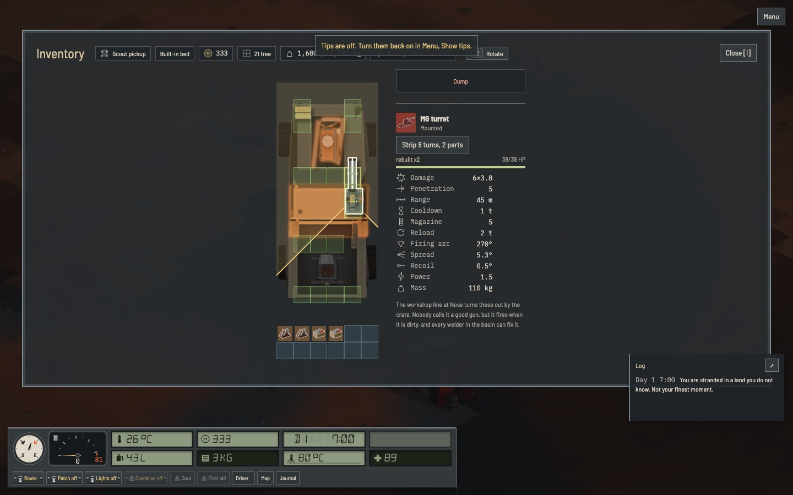
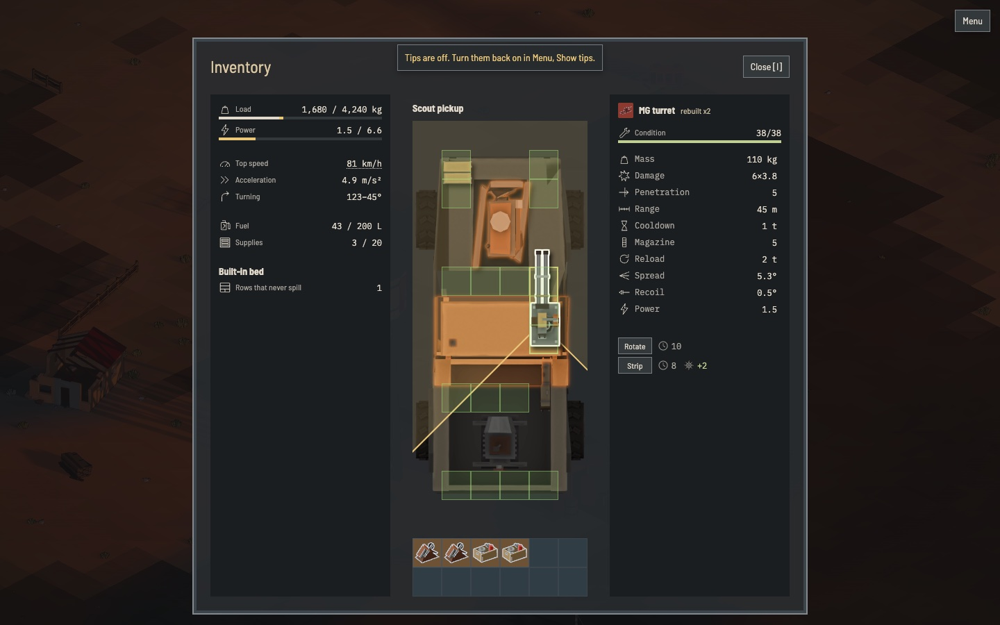

# The inventory before and after

This shows how a confusing screen became a clear one. Copy the reasoning, not the shape. Three columns suit this screen because the player works on a truck and picks parts on it. Another screen answers another question and gets the layout that question needs.

Both images show the same truck with the same gun picked at 1440 by 900.

Before:

After:

## The question

The player asks one thing here: what do I do with this part, and what does my truck look like after it. Every change below follows from that question.

## What changed and why

1. Load and Power moved from head chips to bars at the top of the left column. Every change moves them, so they stay in view and show how full the truck is. The tip used to cover them.
2. Each column got one subject: the truck, the workspace, the pick. The old head mixed the screen title, the truck, the ability, money, a count and Rotate on one row.
3. The top row holds only the title and Close. Rotate moved to the part it acts on, because a control reads as acting on what shares its row.
4. Money, the free cell count, the words Mounted and Spare, the gun's arc and the lore left the screen. The drawing shows the state, and money does not answer the question.
5. Buttons became one verb, with the cost beside them as icon and number. The old button read "Strip 8 turns, 2 parts", so each button had its own width and needed reading in full.
6. Mass moved to the top of the stats, because every part spends that one budget. Condition got a wrench, since a part is not alive.
7. Rows took one form: icon, label, value at the right edge, any bar under it. The eye can run down one edge to compare values.
8. An ability prints as stat rows. A sentence cannot be compared, and its words stay in the tooltip.
9. The truck got the space. It sits in the open middle with no surface, on two thin wells, and its cells grew. The old screen left a third of the frame empty on each side.
10. The Dump box went away. The Dump button takes the drop during a drag, so no large box waits for a rare action.
11. The frame fits the window and the screen never scrolls on a desktop. It reflows before it shrinks, the fit is tested on the largest truck, and fitting beats the click minimum.

## How it got there

1. The user listed complaints: buttons of different sizes, related facts far apart, a useless chip, overall confusion.
2. A mockup in `tmp/` rendered the real pieces with captured game data, and each round was judged on the real window. The early rounds failed, and the user then chose the structure.
3. Each round's verdict and reasons were written down. `docs/ui.md` then gained the rules that would have prevented the old screen, each with a test.
4. `npm run layout` got a check that fails when the screen breaks those rules.

## What the fit cost

The redesign left real work behind. The sorokonoga's cells get small in the garage, and the phone layout stayed stacked. Name the cost of a redesign in its plan.
